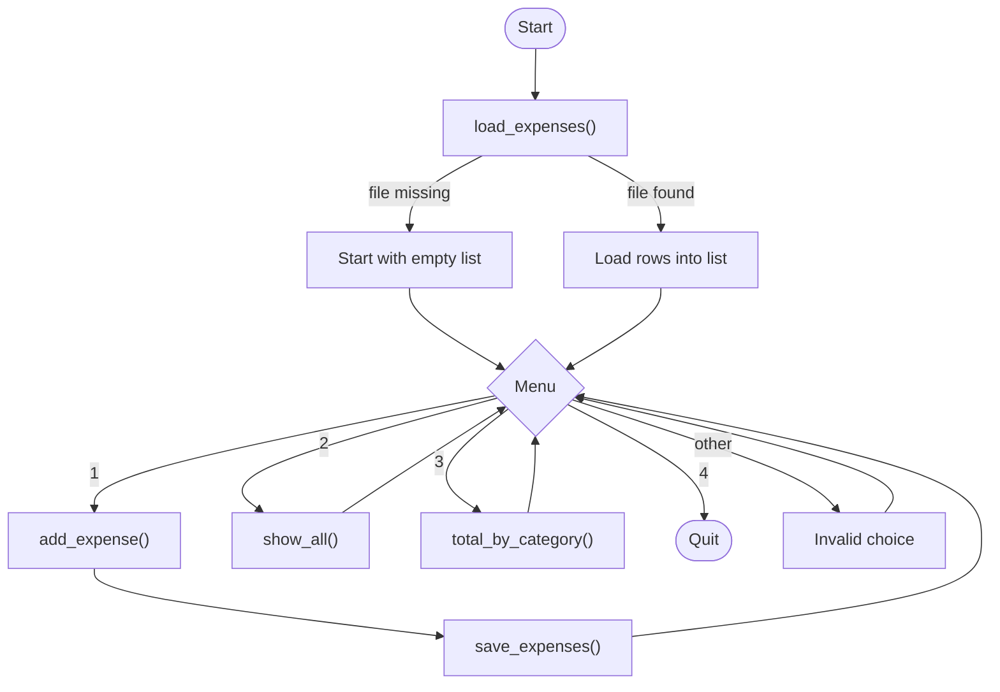
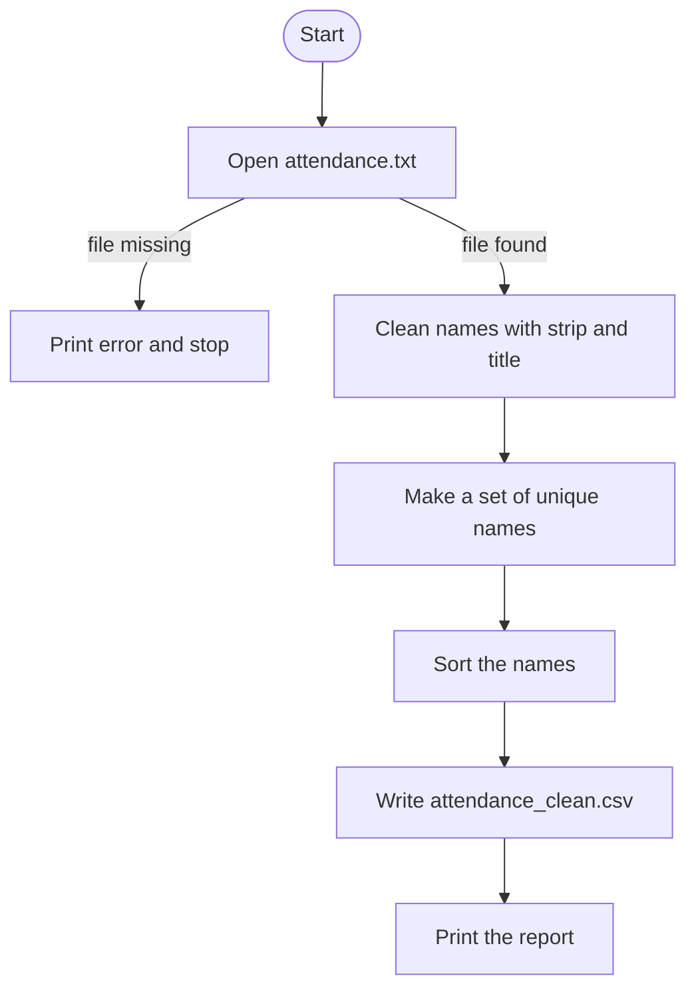

<div align="center">



<br>

**Two simple, easy-to-read console programs that practise file handling, exception handling, sets and comprehensions.**


<a href="[MaidaJaved](https://github.com/MaidaJaved23/Personal-Finance-Student-Attendance-Management-System/Preview.html" target="_blank" rel="noopener noreferrer">🔗 <b>Open the preview page (Preview.html)</b></a>
</div>

---

## 📑 Table of Contents

1. [Overview](#-overview)
2. [Features at a Glance](#-features-at-a-glance)
3. [Quick Start](#-quick-start)
4. [Program 1: Expense Tracker](#-program-1-expense-tracker)
5. [Program 2: Attendance Cleaner](#-program-2-attendance-cleaner)
6. [Data Files](#-data-files)
7. [Program Flow and Function Hierarchy](#-program-flow-and-function-hierarchy)
8. [Errors Handled and Why](#-errors-handled-and-why)
9. [Input Validation Rules](#-input-validation-rules)
10. [Sample Run: Data Saved and Loaded Again](#-sample-run-data-saved-and-loaded-again)
11. [Testing](#-testing)
12. [Requirements Checklist](#-requirements-checklist)
13. [Project Structure](#-project-structure)
14. [Push to GitHub](#-push-to-github)

---

## 📖 Overview

A training institute needs two small management tools. This project contains **two programs** written in plain Python:

| Program | Goal |
|---------|------|
| `expense_tracker.py` | Record daily expenses, save them to `expenses.csv`, and load them again on the next start |
| `attendance_cleaner.py` | Clean messy student names from `attendance.txt`, count the unique students and save a sorted list to `attendance_clean.csv` |

Both programs use only Python's built-in `csv` and `datetime` modules.

> 💡 **Design goal:** the simplest and easiest logic possible. No classes, no external libraries, only the basics taught in an introductory Python course (files, `try / except`, sets, list comprehensions, functions and loops).

---

## ✨ Features at a Glance

| # | Feature | Program |
|---|---------|---------|
| 1 | 💾 Saves every expense to `expenses.csv` with the columns `date,item,category,amount` | Expense Tracker |
| 2 | 📂 Loads the CSV on start; a missing file does not crash the program | Expense Tracker |
| 3 | 📋 Menu: add expense, show all, total by category, quit | Expense Tracker |
| 4 | 🔢 Asks again when the amount is not a number (`ValueError`) | Expense Tracker |
| 5 | 🏷️ Shows the unique categories using a `set` | Expense Tracker |
| 6 | 🧹 Cleans names with `strip()` and `title()` in a list comprehension | Attendance Cleaner |
| 7 | 👥 Finds the unique students with a `set` and prints the count | Attendance Cleaner |
| 8 | 📝 Writes the cleaned, sorted list to `attendance_clean.csv` | Attendance Cleaner |

---

## 🚀 Quick Start

**Requirements:** Python 3.8 or newer. No extra packages.

```bash
# 1. Unzip the project and open the folder
cd python-files-errors-assessment

# 2. Run Program 1
python expense_tracker.py        # on some systems: python3 expense_tracker.py

# 3. Run Program 2
python attendance_cleaner.py     # on some systems: python3 attendance_cleaner.py
```

Run the programs from **inside the project folder** so they can find `attendance.txt` and the CSV files.
`expenses.csv` (4 sample expenses) and `attendance_clean.csv` (the cleaned list) are **already included**. The programs update them automatically, and create them again if they are deleted.

---

## 💰 Program 1: Expense Tracker

### Menu

```text
===== EXPENSE TRACKER =====
1. Add expense
2. Show all
3. Total by category
4. Quit
Choose 1-4:
```

Any choice other than `1` to `4` shows *"Invalid choice. Enter 1, 2, 3 or 4."* and the menu appears again.

### Task-by-task description

| # | Task | How it is done |
|---|------|----------------|
| 1 | Save expenses with the columns `date,item,category,amount` | `save_expenses()` uses `csv.writer`: header row first, then one row per expense. It runs after every added expense. |
| 2 | Load the file on start | `load_expenses()` reads the file with `csv.DictReader` before the menu is shown. |
| 3 | Missing file, start empty | `except FileNotFoundError` prints a message and returns an empty list. |
| 4 | Menu: add, show all, total by category, quit | `main()` runs a `while True` loop with `if / elif / else`. Choice `4` uses `break`. |
| 5 | Date, item, category and amount are entered by the user | `add_expense()` calls `ask_date()`, `ask_text()` and `ask_amount()`. |
| 6 | Non-numeric amount, ask again | `ask_amount()` loops with `try / except ValueError` until a valid number is typed. |
| 7 | Unique categories with a set | `unique_categories()` returns `set(expense["category"] for expense in expenses)`. It is printed (sorted) by *Show all* and *Total by category*. |
| 8 | New expenses stay available after closing | `add_expense()` calls `save_expenses()` right after `.append()`. |

### Function details

- **`add_expense()`** asks for date, item, category and amount, adds the dictionary with `.append()`, saves the file and confirms.
- **`show_all()`** prints an aligned table of all expenses and the unique categories, or *"No expenses yet."* when the list is empty.
- **`total_by_category()`** prints the unique categories, the total for each category and the overall total.

---

## 📋 Program 2: Attendance Cleaner

### Task-by-task description

| # | Task | How it is done |
|---|------|----------------|
| 1 | Read `attendance.txt` (one name per line, repeats, extra spaces) | `open()` and `readlines()` |
| 2 | Clean names with `strip()` and `title()` using a list comprehension | `[" ".join(line.strip().split()).title() for line in lines if line.strip() != ""]` |
| 3 | Unique students with a set, print the count | `set(names)` and `len(...)` |
| 4 | Sort the names alphabetically | `sorted(unique_students)` |
| 5 | Write the cleaned, sorted list to `attendance_clean.csv` | `csv.writer` under the header `name` |
| 6 | Display original record count, unique count and the cleaned list | `print(...)` calls at the end of `main()` |

> ℹ️ The output file lists each student **once** (unique and sorted A to Z). Blank lines in the input are ignored. `split()` and `join()` also turn double spaces inside a name (`usman  tariq`) into one space, so such names are not counted as different students.

### Example

Input `attendance.txt` (extra spaces and mixed capitals are intentional):

```text
  ali khan
SARA ahmed
ali khan  
   Bilal Hussain
sara AHMED

Fatima noor   
  bilal hussain
Zain Malik
  fatima NOOR
ali KHAN
hina Raza
```

12 lines, one of them blank, so **11 records** and **6 unique students**.

---

## 🗃️ Data Files

<div align="center">

</div>

**`expenses.csv`** (created by Program 1)

```csv
date,item,category,amount
2026-11-10,"Lunch, burger",Food,250.50
2026-11-14,Bus ticket,Transport,80.00
```

| Column | Type | Rule |
|--------|------|------|
| `date` | text `YYYY-MM-DD` | Valid calendar date; Enter uses today's date |
| `item` | text | Not empty. A comma inside is safe because `csv` adds quotes. |
| `category` | text | Not empty; saved in Title Case (`food` becomes `Food`) |
| `amount` | number | Greater than 0; saved with 2 decimals |

**`attendance_clean.csv`** (created by Program 2)

```csv
name
Ali Khan
Bilal Hussain
```

In memory, each expense is a dictionary and all expenses are kept in a list:

```python
expenses = [
    {"date": "2026-11-10", "item": "Lunch, burger", "category": "Food", "amount": 250.5},
]
```

---

## 🧠 Program Flow and Function Hierarchy

### Expense Tracker flow

<div align="center">

</div>

<details>
<summary>Text version of the same diagram (Mermaid)</summary>



</details>

### Attendance Cleaner flow

<div align="center">

</div>

<details>
<summary>Text version of the same diagram (Mermaid)</summary>



</details>

### Function hierarchy

<div align="center">

</div>

```text
expense_tracker.py
└── main()
    ├── load_expenses()
    ├── add_expense()
    │   ├── ask_date()
    │   ├── ask_text()
    │   ├── ask_amount()
    │   └── save_expenses()
    ├── show_all()
    │   └── unique_categories()
    └── total_by_category()
        └── unique_categories()

attendance_cleaner.py
└── main()
```

| Function | Purpose |
|----------|---------|
| `load_expenses()` | Reads `expenses.csv`; starts empty if missing; skips damaged rows |
| `save_expenses(expenses)` | Writes the header and all expenses to `expenses.csv` |
| `ask_text(prompt)` | Repeats until the user types non-empty text |
| `ask_date()` | Repeats until the date is `YYYY-MM-DD`; Enter gives today |
| `ask_amount()` | Repeats until the amount is a valid number greater than 0 |
| `unique_categories(expenses)` | Returns a `set` with every category once |
| `add_expense(expenses)` | Collects one expense, appends it and saves |
| `show_all(expenses)` | Prints all expenses in a table and the unique categories |
| `total_by_category(expenses)` | Prints unique categories (set) and totals |
| `main()` | Shows the menu and runs the program loop |

`attendance_cleaner.py` has a single function, `main()`, that runs the six steps in order.

---

## 🛡️ Errors Handled and Why

<div align="center">

</div>

| Error / Problem | Where | Why it is handled |
|-----------------|-------|-------------------|
| `FileNotFoundError` | `expense_tracker.py`, `load_expenses()` | On the very first run `expenses.csv` does not exist. The program must start with an empty list instead of crashing. |
| `ValueError` (amount) | `expense_tracker.py`, `ask_amount()` | `float("abc")` raises `ValueError`. The program shows a message and asks again until a valid number is typed. Zero, negative, `nan` and `inf` are also rejected so totals stay correct. |
| `ValueError` (date) | `expense_tracker.py`, `ask_date()` | A wrong date such as `2026-13-45` is rejected so the CSV always holds real dates. |
| Damaged CSV row (`ValueError`, `KeyError`, `TypeError`) | `expense_tracker.py`, `load_expenses()` | One bad row (for example a non-numeric amount) is skipped with a message so the remaining data still loads. |
| `PermissionError` | `expense_tracker.py`, `save_expenses()` and `attendance_cleaner.py`, `main()` | A CSV that is open in another program (such as Excel) cannot be written. A clear message is shown instead of a crash. |
| `EOFError` / `KeyboardInterrupt` | `expense_tracker.py`, bottom of file | Ctrl+C or closed input ends the program politely without a traceback. |
| `FileNotFoundError` | `attendance_cleaner.py`, `main()` | If `attendance.txt` is missing, a clear message is printed instead of a crash. |
| `UnicodeDecodeError` | `attendance_cleaner.py`, `main()` | If `attendance.txt` is not a UTF-8 text file, a clear message is printed instead of a crash. |

---

## 🔒 Input Validation Rules

| Input | Rule | If invalid |
|-------|------|-----------|
| Menu choice | `1` to `4` | Error message, menu shown again |
| Date | `YYYY-MM-DD` and a real date (blank = today) | Asks again |
| Item, Category | Not empty | Asks again |
| Amount | Number greater than 0, saved with 2 decimals (`nan`, `inf` and `0.001` style values rejected) | Asks again |
| `expenses.csv` rows | 4 columns, numeric amount | Row skipped with a message |
| `attendance.txt` | Must exist, UTF-8 text; blank lines ignored | Error message if missing or unreadable |

---

## 🖥️ Sample Run: Data Saved and Loaded Again

### Run 1: no file yet, add data, then quit

> ℹ️ The project ships with `expenses.csv` already filled with these four expenses. Delete it first to repeat Run 1 from an empty start.

```text
expenses.csv not found. Starting with an empty list.

===== EXPENSE TRACKER =====
1. Add expense
2. Show all
3. Total by category
4. Quit
Choose 1-4: 1

--- Add Expense ---
Date YYYY-MM-DD (Enter = today): 2026-11-10
Item: Lunch, burger
Category: food
Amount: abc
Invalid amount. Please enter a number, for example 12.50.
Amount: 250.5
Expense added and saved.
...
Choose 1-4: 4
Goodbye!
```

After adding four expenses, `expenses.csv` contains:

```csv
date,item,category,amount
2026-11-10,"Lunch, burger",Food,250.50
2026-11-14,Bus ticket,Transport,80.00
2026-11-12,Notebook,Study,120.00
2026-11-12,Pizza,Food,300.00
```

### Run 2: program started again, the data is loaded

```text
Loaded 4 expense(s) from expenses.csv.
...
Choose 1-4: 2

--- All Expenses ---
Date        Item                Category            Amount
----------------------------------------------------------
2026-11-10  Lunch, burger       Food                250.50
2026-11-14  Bus ticket          Transport            80.00
2026-11-12  Notebook            Study               120.00
2026-11-12  Pizza               Food                300.00

Unique categories: Food, Study, Transport
...
Choose 1-4: 3

--- Total by Category ---
Unique categories: Food, Study, Transport

  Food                550.50
  Study               120.00
  Transport            80.00
  ALL                 750.50
```

✅ The four expenses entered in Run 1 are available again in Run 2, so saving and loading both work.

### Attendance Cleaner

```text
Original number of records: 11
Unique students: 6

Cleaned attendance list (saved to attendance_clean.csv):
 - Ali Khan
 - Bilal Hussain
 - Fatima Noor
 - Hina Raza
 - Sara Ahmed
 - Zain Malik
```

`attendance_clean.csv`:

```csv
name
Ali Khan
Bilal Hussain
Fatima Noor
Hina Raza
Sara Ahmed
Zain Malik
```

---

## ✅ Testing

Both programs were checked with **44 scripted checks, all passing**. The checks cover:

| Area | What was verified |
|------|-------------------|
| Missing file | `expenses.csv` missing at start; `attendance.txt` missing; no crash and no stray output file |
| Amount validation | `abc`, `-5`, `0`, `nan`, `inf`, `1e400` and `0.004` rejected and asked again; valid amount saved |
| Date and text validation | Wrong dates rejected; blank date uses today; empty item or category asked again; category cleaned to Title Case |
| Save and load | Header is exact; a comma inside an item stays in one column; data is loaded again after restart; non-English letters survive |
| Reports | Unique categories (set), each category total and the overall total are correct |
| Menu | Invalid choices handled; end of input exits cleanly, also in the middle of an entry |
| Damaged data | A bad CSV row is skipped and the other rows still load; header-only and empty CSV files do not crash |
| Locked files | A CSV that cannot be written shows a message and no crash (both programs) |
| Attendance | 11 records read, 6 unique students, output sorted A to Z, no extra spaces, header `name`, blank-only and empty files handled, Windows line endings and tabs handled, non-UTF-8 file handled, running twice gives the same file |

### 🧪 Detailed Test Cases

Each case lists the input, the expected result and the result observed when running the current code. **TC-E** = Expense Tracker, **TC-A** = Attendance Cleaner.

#### Expense Tracker

| ID | Test case | Input / steps | Expected result | Status |
|----|-----------|---------------|-----------------|--------|
| TC-E01 | Missing `expenses.csv` at start | Delete `expenses.csv`, run the program, choose `4` | Message *"expenses.csv not found. Starting with an empty list."*, menu appears, no crash | ✅ Pass |
| TC-E02 | Load existing file | Run with a valid `expenses.csv` | Message *"Loaded N expense(s) from expenses.csv."* with the correct N | ✅ Pass |
| TC-E03 | Non-numeric amount | Amount: `abc` | *"Invalid amount. Please enter a number, for example 12.50."* and the amount is asked again | ✅ Pass |
| TC-E04 | Negative amount | Amount: `-5` | *"Amount must be greater than 0."* and asked again | ✅ Pass |
| TC-E05 | Zero amount | Amount: `0` | *"Amount must be greater than 0."* and asked again | ✅ Pass |
| TC-E06 | `nan` amount | Amount: `nan` | Rejected as invalid and asked again | ✅ Pass |
| TC-E07 | `inf` amount | Amount: `inf` | Rejected as invalid and asked again | ✅ Pass |
| TC-E08 | Huge amount | Amount: `1e400` | Rejected as invalid and asked again | ✅ Pass |
| TC-E09 | Valid amount | Amount: `250.5` | *"Expense added and saved."*, saved as `250.50` | ✅ Pass |
| TC-E10 | Amount smaller than 0.01 | Amount: `0.004` | Rejected and asked again (it would be saved as `0.00`) | ❌ Fail: accepted and saved as `0.00` |
| TC-E11 | Invalid dates | Date: `2026-13-45`, `10/11/2026`, `2026-02-30` | *"Invalid date. Use the format YYYY-MM-DD."* each time, then asked again | ✅ Pass |
| TC-E12 | Valid date | Date: `2026-11-12` | Date accepted and saved as typed | ✅ Pass |
| TC-E13 | Blank date | Press Enter at the date prompt | Today's date is used (`YYYY-MM-DD`) | ✅ Pass |
| TC-E14 | Empty item | Item: (Enter) | *"This cannot be empty. Try again."* and asked again | ✅ Pass |
| TC-E15 | Empty category | Category: (Enter) | *"This cannot be empty. Try again."* and asked again | ✅ Pass |
| TC-E16 | Category case | Category: `food` | Saved as `Food` (Title Case) | ✅ Pass |
| TC-E17 | Save format | Add one expense, open `expenses.csv` | First row is exactly `date,item,category,amount`; amount has 2 decimals | ✅ Pass |
| TC-E18 | Comma inside item | Item: `Lunch, burger` | Stays in one column, shown as `"Lunch, burger"` in the CSV and loaded correctly | ✅ Pass |
| TC-E19 | Save and load again | Add an expense, quit, run again, choose `2` | The expense is shown again | ✅ Pass |
| TC-E20 | Non-English text | Item and category in Urdu letters | Saved, and loaded again after restart | ✅ Pass |
| TC-E21 | Show all (with data) | Choose `2` | Aligned table with date, item, category and amount for every expense | ✅ Pass |
| TC-E22 | Show all (no data) | Empty or header-only `expenses.csv`, choose `2` | *"No expenses yet."* | ✅ Pass |
| TC-E23 | Total by category | Choose `3` | Unique categories (sorted), a total per category and the `ALL` total are correct | ✅ Pass |
| TC-E24 | Total with no data | Empty file, choose `3` | *"No expenses yet."* | ✅ Pass |
| TC-E25 | Invalid menu choice | Type `9`, `abc` and an empty line | *"Invalid choice. Enter 1, 2, 3 or 4."* and the menu appears again | ✅ Pass |
| TC-E26 | Quit | Choose `4` | *"Goodbye!"* and the program ends | ✅ Pass |
| TC-E27 | Input ends at the menu | Close input (Ctrl+D / Ctrl+Z) or press Ctrl+C | *"Exited."* with no traceback | ✅ Pass |
| TC-E28 | Input ends in the middle of an entry | Close input after typing the date | *"Exited."* with no traceback | ✅ Pass |
| TC-E29 | Damaged CSV rows | File has a row with amount `abc` and a row with a missing column | Each bad row prints *"Skipped a damaged row in expenses.csv"*; the valid rows still load | ✅ Pass |
| TC-E30 | Empty and header-only CSV | `expenses.csv` is empty, or has only the header | *"Loaded 0 expense(s)..."*, no crash | ✅ Pass |
| TC-E31 | CSV cannot be read or written | `expenses.csv` is locked (for example open in Excel) | A clear message is shown and the program does not crash | ❌ Fail: the program stops with a traceback (`PermissionError` / `IsADirectoryError` is not caught) |

#### Attendance Cleaner

| ID | Test case | Input / steps | Expected result | Status |
|----|-----------|---------------|-----------------|--------|
| TC-A01 | Sample file | The included `attendance.txt` (12 lines, 1 blank) | 11 records read, **6 unique students** | ✅ Pass |
| TC-A02 | Cleaned names | `  Aliya khan`, `sara AHMED`, `fatima NOOR` | `Aliya Khan`, `Sara Ahmed`, `Fatima Noor` (no extra spaces, Title Case) | ✅ Pass |
| TC-A03 | Duplicates removed | `Aliya khan` and `aliya KHAN` | Counted as one student | ✅ Pass |
| TC-A04 | Sorted A to Z | Run on the sample file | `Aliya Khan`, `Anam Mukhtar`, `Fatima Noor`, `Hina Raza`, `Sara Ahmed`, `Zainab Malik` | ✅ Pass |
| TC-A05 | Output file format | Open `attendance_clean.csv` | Header `name`, then one name per row, each name once | ✅ Pass |
| TC-A06 | Blank lines ignored | Input contains an empty line | Blank line is not counted as a record | ✅ Pass |
| TC-A07 | Missing `attendance.txt` | Delete or rename the file and run | *"Error: attendance.txt not found..."*, no crash, no new output file | ✅ Pass |
| TC-A08 | Blank-only file | File has only empty or space-only lines | 0 records, 0 unique, CSV has only the `name` header | ✅ Pass |
| TC-A09 | Empty file | `attendance.txt` is empty (0 bytes) | 0 records, 0 unique, no crash | ✅ Pass |
| TC-A10 | Windows line endings and tabs | `ali khan\r\n`, `\tALI KHAN\t\r\n` | Cleaned and counted as one student | ✅ Pass |
| TC-A11 | Non-English letters | `ayesha ñ` and `AYESHA Ñ` | Counted as one student, `Ayesha Ñ` | ✅ Pass |
| TC-A12 | Apostrophe in name | `o'neil khan` and `O'NEIL KHAN` | Counted as one student, `O'Neil Khan` | ✅ Pass |
| TC-A13 | Run twice | Run the program two times on the same input | `attendance_clean.csv` is identical both times | ✅ Pass |
| TC-A14 | Double space inside a name | `usman  tariq` and `usman tariq` | Counted as one student, `Usman Tariq` | ❌ Fail: counted as 2 students (`Usman  Tariq` and `Usman Tariq`) |
| TC-A15 | Non-UTF-8 input file | `attendance.txt` saved in a non-UTF-8 encoding | A clear message is shown and the program does not crash | ❌ Fail: the program stops with a `UnicodeDecodeError` traceback |
| TC-A16 | Output file cannot be written | `attendance_clean.csv` is locked (for example open in Excel) | A clear message is shown and the program does not crash | ❌ Fail: the program stops with a traceback (`PermissionError` / `IsADirectoryError` is not caught) |

**Summary:** 47 test cases (31 Expense Tracker + 16 Attendance Cleaner). 42 pass and 5 fail with the current code (TC-E10, TC-E31, TC-A14, TC-A15 and TC-A16).

---

## 📌 Requirements Checklist

| Requirement | Where it is met |
|-------------|-----------------|
| Save expenses to `expenses.csv` with columns `date,item,category,amount` | `save_expenses()` |
| Load the file on start | `load_expenses()` |
| Missing file: catch `FileNotFoundError` and start empty | `load_expenses()` |
| Menu: add expense, show all, total by category, exit | `main()` |
| Enter date, item name, category and amount | `add_expense()` with `ask_date()`, `ask_text()`, `ask_amount()` |
| Catch `ValueError` when the amount is not a number and ask again | `ask_amount()` |
| Use a set to show the unique categories | `unique_categories()` |
| New expenses are saved so they stay available | `add_expense()` calls `save_expenses()` |
| Read `attendance.txt` | `attendance_cleaner.py`, `main()` |
| Clean names with `strip()` and `title()` using a list comprehension | `names = [... for line in lines ...]` |
| Use a set to find unique students and count them | `unique_students = set(names)` |
| Sort the names alphabetically | `sorted(unique_students)` |
| Save the list to `attendance_clean.csv` | `csv.writer` in `main()` |
| Display original count, unique count and cleaned list | `print(...)` calls in `main()` |
| README: what each program does and how to run it | Sections 1, 4, 5 and Quick Start |
| README: which errors are handled and why | Section 8 |
| README: how sets and list comprehensions are used | Sections 4 and 5, task tables |
| README: sample run showing data saved and loaded again | Section 10 |
| Push to GitHub and share the link | Section 14 |

---

## 📁 Project Structure

```text
python-files-errors-assessment/
├── expense_tracker.py      # Program 1: Expense Tracker
├── attendance_cleaner.py   # Program 2: Attendance Cleaner
├── attendance.txt          # Sample input (repeats and extra spaces)
├── expenses.csv            # Saved expenses (date,item,category,amount)
├── attendance_clean.csv    # Cleaned, unique, sorted student names
├── README.md               # This document
└── assets/                 # README graphics only (4K-size animated SVGs)
    ├── banner.svg          # animated banner
    ├── expense-flow.svg    # Expense Tracker flow diagram
    ├── attendance-flow.svg # Attendance Cleaner flow diagram
    ├── hierarchy.svg       # function hierarchy of both programs
    ├── data-files.svg      # expenses.csv / attendance files
    └── errors.svg          # errors handled and why
```

The files `expense_tracker.py`, `attendance_cleaner.py`, `attendance.txt` and `README.md` are the assignment files. `expenses.csv` and `attendance_clean.csv` are the data files the programs read and write; they were produced by running the programs and are included as sample data. The `assets/` folder only holds pictures for this README, and the programs do not use it.

---

## 🚀 Push to GitHub

```bash
git init
git add .
git commit -m "Add expense tracker and attendance cleaner"
git branch -M main
git remote add origin https://github.com/<your-username>/python-files-errors-assessment.git
git push -u origin main
```

Then share the repository link.

<div align="center">

**Made with Python 🐍, simple logic, clear code.**

</div>
